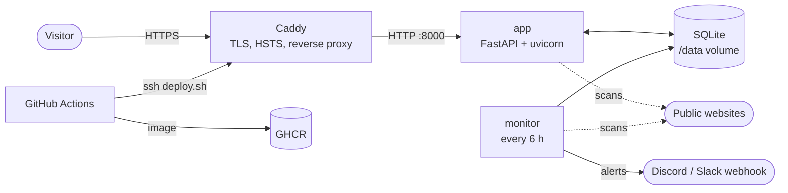

# sitecheck

[](https://github.com/aleksandersarkezi/sitecheck/actions/workflows/ci.yml)
[](https://github.com/aleksandersarkezi/sitecheck/actions/workflows/deploy.yml)

A CLI tool that checks a website's security setup: response headers, TLS
certificate, cookies, and whether `http://` actually redirects to `https://`.
Everything it does is a normal request a browser already makes when loading a
page. No scanning, no fuzzing, no probing for vulnerabilities. At the end you
get a score and a letter grade, A through F.

## What it checks

| Check | Why it matters |
| --- | --- |
| **Strict-Transport-Security (HSTS)** | Forces the browser to use HTTPS on every future visit. Without it, someone who types `http://` or clicks an old link can be downgraded to plain HTTP by anyone on the network. |
| **Content-Security-Policy (CSP)** | Probably the single strongest defense against XSS. It locks down which scripts, styles, and resources a page is allowed to load. |
| **X-Frame-Options / CSP `frame-ancestors`** | Stops the page from being loaded in someone else's `<iframe>`. Skip it and you're open to clickjacking. |
| **X-Content-Type-Options** | `nosniff` keeps the browser from guessing content types on its own, a trick that's been used to turn file uploads into executable scripts. |
| **Referrer-Policy** | Controls how much of the current URL leaks to other sites through the `Referer` header when a link gets clicked. Matters a lot if your URLs carry tokens or query params. |
| **Permissions-Policy** | Locks down camera, mic, geolocation, and similar browser features so an injected or third-party script can't just ask for them. |
| **TLS certificate** | Valid or not, who issued it, how many days are left before it expires (flags anything under 14 days), and which TLS version got negotiated. |
| **HTTP → HTTPS redirect** | Confirms plain `http://` traffic actually gets upgraded, not just that the `https://` version happens to work. |
| **Server / X-Powered-By** | Flags headers that hand an attacker a software version for free, saving them a lookup. |
| **Cookies** | Checks every `Set-Cookie` header for `Secure`, `HttpOnly`, and `SameSite`. |

Scoring logic lives in [`src/sitecheck/scoring.py`](src/sitecheck/scoring.py),
kept separate from the networking code so it's testable on its own. A score
of 90+ is an A, 80+ a B, 70+ a C, 60+ a D, anything below that is an F.

## Installation

Requires Python 3.11+.

```bash
pip install git+https://github.com/aleksandersarkezi/sitecheck.git
```

For local development:

```bash
git clone https://github.com/aleksandersarkezi/sitecheck.git
cd sitecheck
pip install -e ".[dev]"
```

## Usage

```bash
sitecheck example.com
```

Check several sites from a file (one host per line, `#` for comments):

```bash
sitecheck -f urls.txt
```

Machine-readable output for scripting:

```bash
sitecheck example.com --json
```

Custom network timeout in seconds (default is 10):

```bash
sitecheck example.com --timeout 5
```

Use it as a CI gate, exits non-zero if any site scores below the given grade:

```bash
sitecheck example.com --fail-under C
```

### Example output

```text
$ sitecheck example.com
--------------------------------- example.com ---------------------------------
+-----------------------------------------------------------------------------+
| Check                     | Status | Details                                |
|---------------------------+--------+----------------------------------------|
| Strict-Transport-Security | FAIL   | header missing: browsers may be        |
|                           |        | tricked into using plain HTTP          |
| Content-Security-Policy   | FAIL   | header missing: no mitigation against  |
|                           |        | XSS/injection via content restrictions |
| Frame protection          | FAIL   | no X-Frame-Options and no CSP          |
|                           |        | frame-ancestors: page can be framed    |
|                           |        | (clickjacking risk)                    |
| X-Content-Type-Options    | FAIL   | header missing: browsers may           |
|                           |        | MIME-sniff responses                   |
| Referrer-Policy           | WARN   | header missing: full URLs (possibly    |
|                           |        | with sensitive query params) may leak  |
|                           |        | via Referer                            |
| Permissions-Policy        | WARN   | header missing: browser features       |
|                           |        | (camera, mic, geolocation, ...) are    |
|                           |        | not explicitly restricted              |
| Server                    | INFO   | reveals software name: 'cloudflare'    |
| X-Powered-By              | OK     | header not present                     |
| Cookies                   | INFO   | no cookies set                         |
| TLS Certificate           | OK     | issuer=SSL Corporation, expires in     |
|                           |        | 73d, TLSv1.3                           |
| HTTP -> HTTPS redirect    | FAIL   | http:// does not redirect to HTTPS     |
|                           |        | (ended at http://example.com)          |
+-----------------------------------------------------------------------------+
Score: 33/100  Grade: F
```

Colors and proper box-drawing characters show up automatically once your
terminal supports them.

## Web service and monitoring

Besides the CLI, sitecheck runs as a small self-hosted service:

- a **web UI and JSON API** where anyone can check a site,
- a **monitor** that re-checks a watchlist every few hours, stores the
  history in SQLite and posts to Discord/Slack when a grade drops, a site goes
  down or a certificate is about to expire,
- **Prometheus metrics** for the checks and the monitored sites.



Everything runs from one Docker image with Docker Compose on a single VPS.
GitHub Actions lints, tests and smoke-tests the image on every push; when
`main` is green it builds the image, pushes it to GitHub Container Registry
and deploys it over SSH. If the new version fails its health check, the
deploy script rolls back to the previous image on its own.

Full server setup, step by step: [docs/DEPLOY.md](docs/DEPLOY.md).

### API

| Endpoint | What it returns |
| --- | --- |
| `GET /api/check?host=example.com` | Full report, same shape as `sitecheck --json`, plus `cached` |
| `GET /api/monitored` | Latest result for every monitored site |
| `GET /api/monitored/{host}?limit=30` | Check history for one monitored site |
| `GET /healthz` | `{"status": "ok"}` for Docker and uptime checks |
| `GET /metrics` | Prometheus metrics (blocked from the internet by Caddy) |
| `GET /api/docs` | Interactive OpenAPI docs |

### Security decisions

A service that makes HTTP requests to whatever a stranger types in is an SSRF
risk by design, so most of the work went into what it refuses to do:

- **Input validation** (`src/sitecheck/guard.py`): only bare public hostnames.
  No IP literals, ports, credentials or non-HTTP schemes, and the hostname must
  resolve exclusively to public addresses (no `127.0.0.1`, `10.x`,
  `169.254.169.254`, IPv4-mapped IPv6 and so on).
- **Every redirect hop is re-checked.** The httpx transport is wrapped so a
  public site answering `302 Location: http://169.254.169.254/` gets blocked
  instead of followed. Only ports 80 and 443 are allowed anywhere in the chain.
- **Defense in depth on the server:** containers can't reach the metadata
  endpoint (an iptables rule in `DOCKER-USER`), run as a non-root user with a
  read-only filesystem, no Linux capabilities and memory/CPU limits.
- **Abuse limits:** fresh checks are rate-limited per visitor IP, results are
  cached for 10 minutes, and at most 4 scans run at once.
- **Output escaping:** scanned sites control their own headers and certificate
  names, so every value is HTML-escaped before rendering. Tests cover both
  user input and hostile values coming back from a scanned site.
- **The service passes its own check:** strict CSP with no inline styles or
  scripts, HSTS, frame protection, no `Server` header. It scores 100/A.
- **Deploy security:** a dedicated SSH key, a pinned host key instead of
  trust-on-first-use, secrets scoped to a GitHub `production` environment.

Known limitation: DNS rebinding. The hostname is resolved once for the check
and again when connecting, so a malicious DNS server with a tiny TTL could
answer differently the second time. The iptables rule above still blocks the
most valuable internal target; pinning the resolved IP per request would
close the gap completely.

### Running the service locally

```bash
pip install -e ".[dev]"
uvicorn sitecheck.service.app:create_app_from_env --factory --reload
# http://127.0.0.1:8000

echo "example.com" > sites.txt
sitecheck-monitor --watchlist sites.txt --db data/sitecheck.db
```

Or the whole stack except Caddy, with Docker:

```bash
docker build -t sitecheck .
docker run --rm -p 127.0.0.1:8000:8000 -v sitecheck_data:/data sitecheck
```

## Responsible use

sitecheck only sends the kind of request a browser already sends when
loading a page: no login attempts, no form submissions, no path enumeration.
That said, point it only at sites you own or are otherwise allowed to test.
Automated requests against someone else's site can violate their terms of
service even when nothing you send is actually harmful.

The public web instance sends one page load's worth of requests per check
(the same thing services like securityheaders.com do), caches results so
repeated checks don't hit the target again, and rate-limits each visitor. The
monitor only checks sites listed in `sites.txt` by whoever runs the server.

## Development

```bash
pip install -e ".[dev]"
ruff check .
pytest
```

## License

MIT, see [LICENSE](LICENSE).
